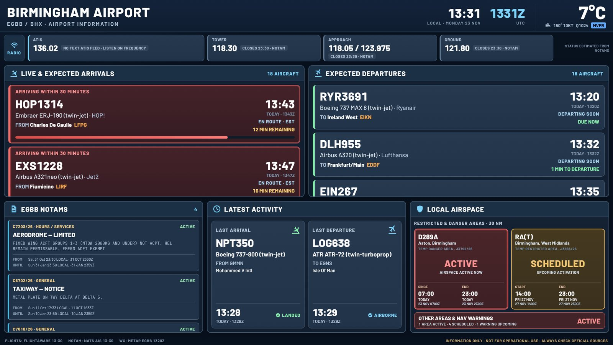
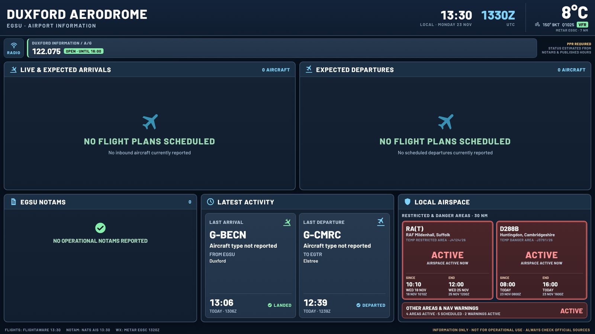
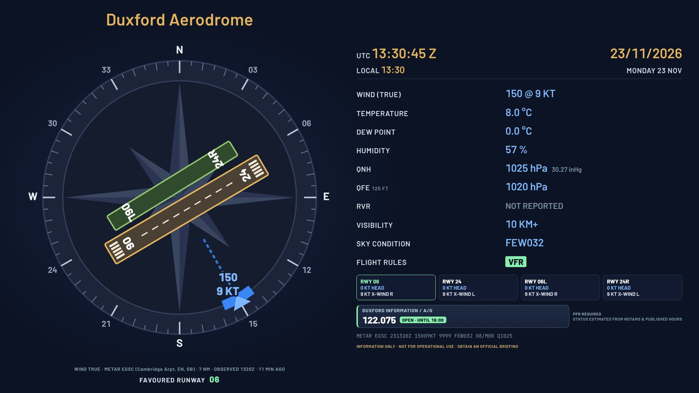
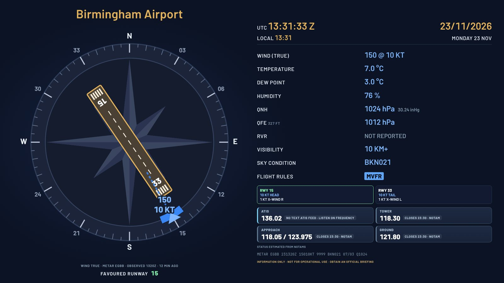
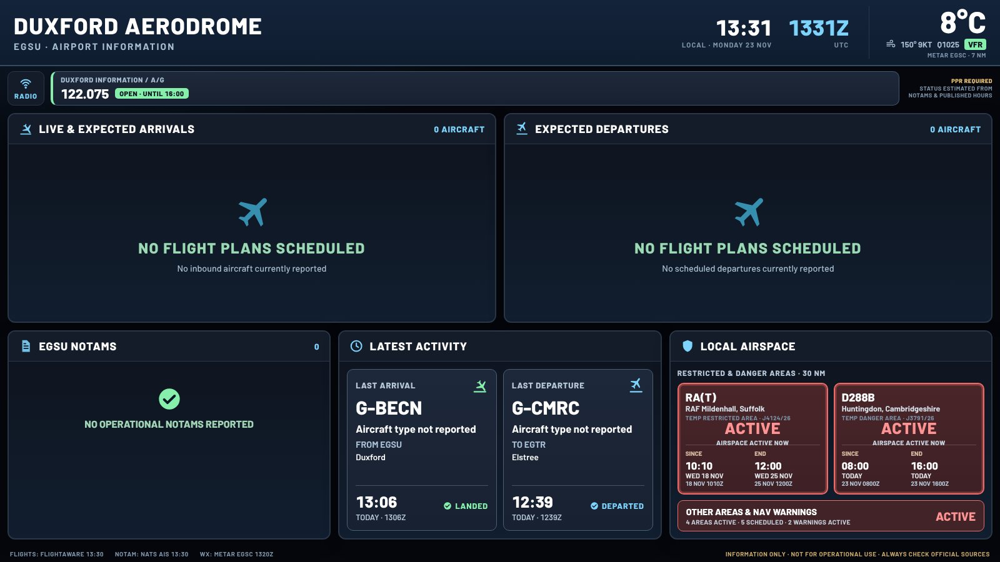
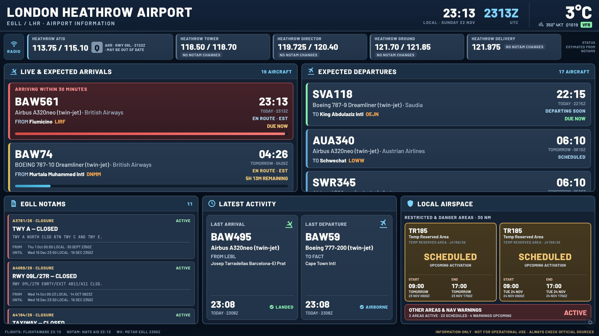
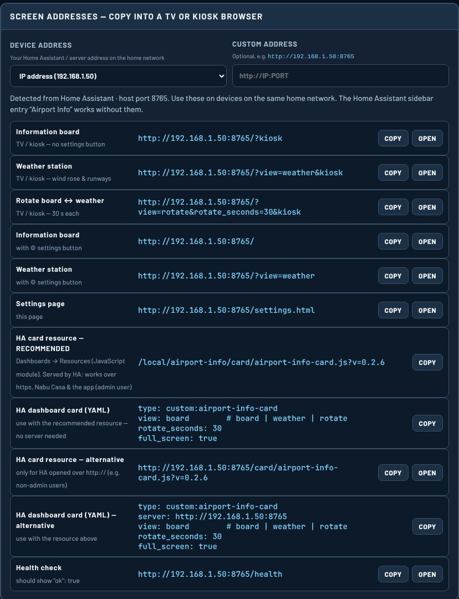
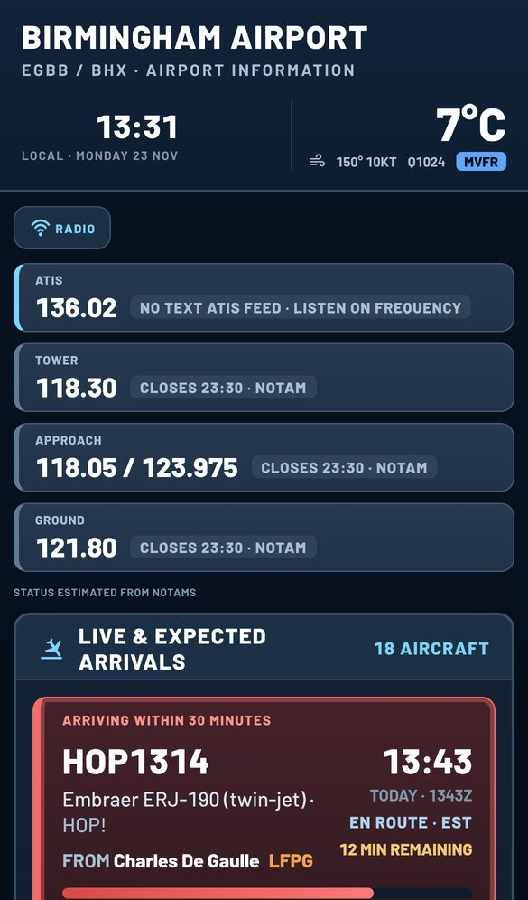
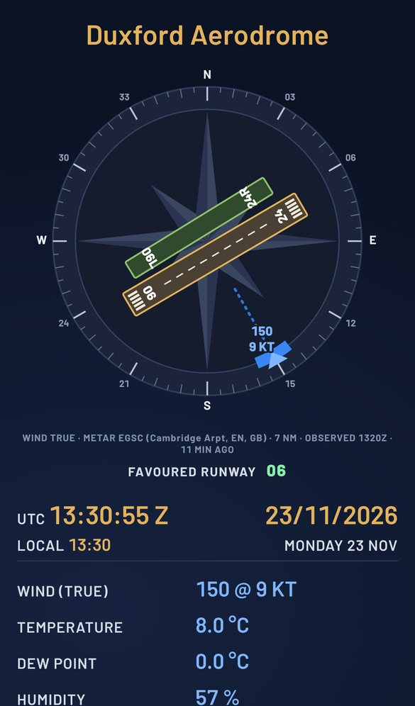

# Airport-Info
Screens for local airport — live arrivals, departures, NOTAMs, latest activity, weather and local
restricted/danger airspace for **any UK airport** (choose by ICAO `EGBJ` or IATA `GLO`).
Runs as a **website** and as a **Home Assistant** dashboard (same board in both).



Two screens, plus a settings page. Default airport: **EGSU Duxford**.

- **Information board** (`/`):
  - live and expected arrivals/departures, with "arriving within 30/60 minutes" alerts;
  - interpreted NOTAMs, latest activity, and local restricted/danger airspace with live activation status;
  - a **radio strip**: the airfield's frequencies, an open/closed estimate from NOTAMs and opening hours, and
    the current ATIS letter where a real text ATIS exists.
- **Weather station** (`/weather`): wind rose with the airfield's real runways, QNH/QFE, RVR, crosswind
  components, favoured runway. `/?view=rotate` alternates the two screens.

## Screenshots
| | |
|---|---|
| **Duxford: information board** (default airport, a quiet GA field)<br> | **Duxford: weather station**<br> |
| **Birmingham: weather station** (single runway 15/33)<br> | **Home Assistant dashboard card** (midnight theme)<br> |
| **Heathrow: radio strip with a live text-ATIS letter**<br> | **Settings: copy-ready screen addresses** with the device's real IP<br> |

<p>
  
  
  <br><em>On a phone the same pages become a scrolling layout.</em>
</p>

Screenshots were taken on 23 Nov 2026 with live data, so the content varies with the time of day.
The full settings page is [here](docs/screenshots/settings.jpg).

## Quick start
```bash
pip install -r server/requirements.txt
PYTHONPATH=server python -m airport_info.app
# open http://localhost:8080  ·  settings: http://localhost:8080/settings.html
```
or `docker compose up -d --build`.

**Home Assistant:** follow the step-by-step guide → [docs/SETUP_HOME_ASSISTANT.md](docs/SETUP_HOME_ASSISTANT.md)
(add-on with sidebar panel, TV/kiosk URLs, full-screen dashboard card, optional sensors).

## Data
- Flights: FlightAware airport board (web scrape)
- NOTAMs: NATS AIS PIB feed (free, official UK)
- Airspace: UK AIP ENR 5.1 areas (YAIXM dataset, scraped) + NOTAM activations
- Weather: METAR via aviationweather.gov

**Information only — not for operational use. Always check official sources before flight.**

Developer / AI handover notes: [CLAUDE.md](CLAUDE.md). Original KIMS design: [reference/](reference/).
