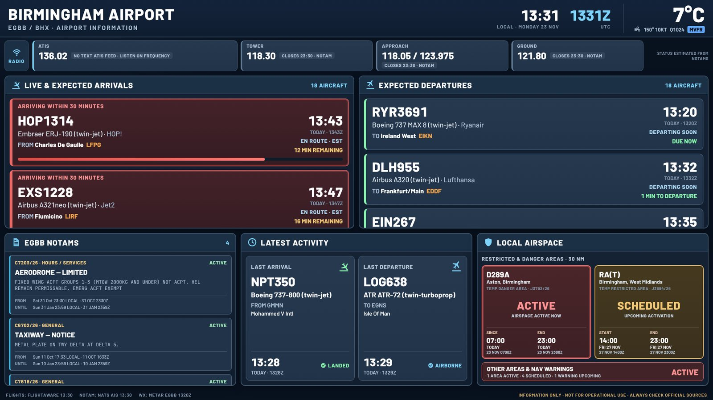
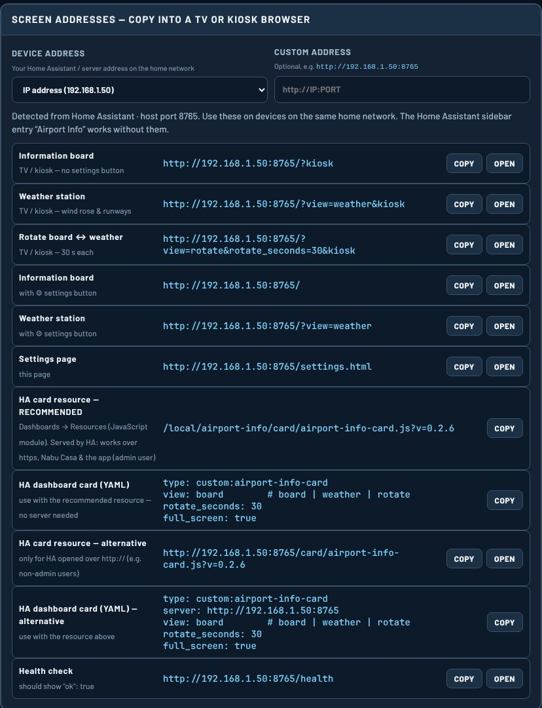
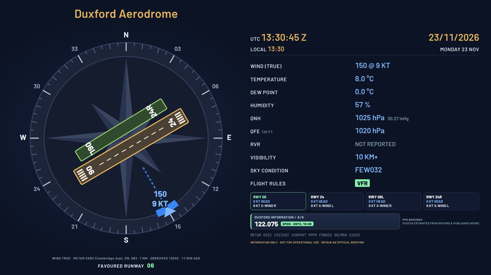
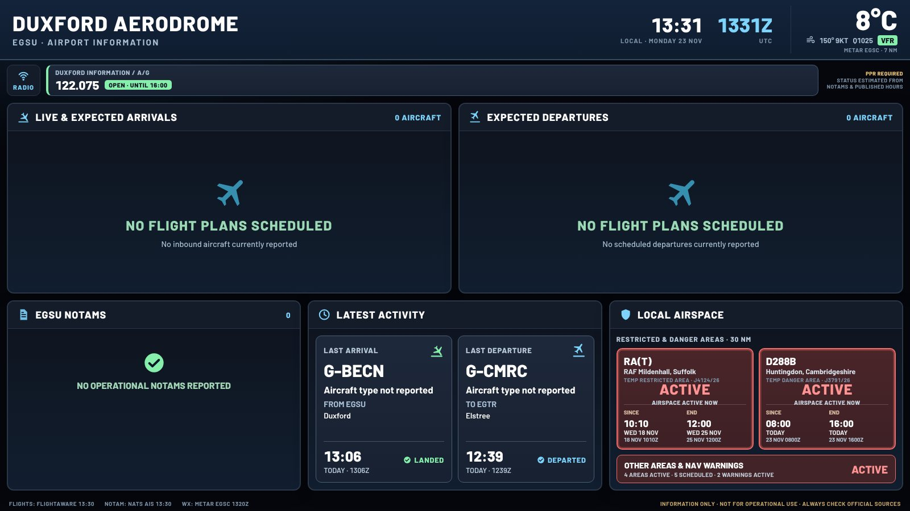

# Airport Info on Home Assistant

Put live airport screens on your TVs: arrivals, departures, NOTAMs, local airspace, radio frequencies and a
weather station with the airfield's runways. It works for **any UK airport** and defaults to **EGSU Duxford**.



**You'll need:** a 64-bit Home Assistant with the **Add-ons** menu (Home Assistant OS or Supervised) and about
10 minutes. No Add-ons menu? See *Use Docker instead* at the end.

> Information only. Not for operational use. Always get an official briefing before flight.

## Quick start

| | Step | Time |
|---|---|---|
| 1 | [Install the add-on](#1-install-the-add-on) | 3–15 min (mostly waiting) |
| 2 | [Start it](#2-start-it) | 1 min |
| 3 | [Choose your airport](#3-choose-your-airport) | 1 min |
| 4 | [Put it on your screens](#4-put-it-on-your-screens) | 2 min per screen |

---

## 1. Install the add-on

1. In Home Assistant go to **Settings → Add-ons → Add-on Store**.
2. Tap **⋮** (top right) → **Repositories**, paste the address below, then tap **Add**:
   ```
   https://github.com/madmonkeyfpv/Airport-Info
   ```
3. Close the box and refresh the page. Find **Airport Info**, open it and tap **Install**.

Home Assistant builds the add-on on your machine. Expect about 2 minutes on a PC, or up to 15 on a Raspberry Pi.

<details>
<summary>Can't add the repository? Install it as a local add-on instead</summary>

1. Install the **Samba share** add-on, set a username and password on its Configuration tab, and start it.
2. On GitHub, open the repository and use **Code → Download ZIP**, then unzip it.
3. Open the `addons` share: `\\<HA-IP>\addons` on Windows, or `smb://<HA-IP>/addons` on a Mac.
4. Create a folder `airport_info` and copy the **contents** of the unzipped folder into it, so that
   `addons/airport_info/config.yaml` exists.
5. Back in the Add-on Store, tap **⋮** → **Check for updates** and refresh. **Airport Info** appears under
   **Local add-ons**. Tap **Install**.
</details>

## 2. Start it

On the add-on's **Info** tab:

1. Turn on **Start on boot**, **Watchdog** and **Show in sidebar**.
2. Tap **Start**.
3. **Airport Info** now appears in the sidebar. Tap it and the board opens.

✅ The add-on's **Log** tab should show `[airport-info] starting` and `dashboard card installed`.

<details>
<summary>Optional: stop other people changing the settings, or change the port</summary>

- **Lock the settings:** on the **Configuration** tab, set an `admin_token`, which works like a password. The
  settings page then asks for it before saving.
- **Port:** TVs reach the add-on on port **8765**. If starting fails with *"port … is already in use"*, change the
  number under **Configuration → Network** (e.g. to `8766`), then save and start. Use your number wherever this guide
  says `8765`.
</details>

## 3. Choose your airport

1. In the sidebar board, tap the faint **⚙** (bottom right).
2. Type an airport code or name, e.g. `EGSU`, `GLO` or `Gloucester`, and pick it from the list.
3. Choose the **Screen**: *Information board*, *Weather station*, or *Rotate* (alternates the two).
4. Tap **SAVE SETTINGS**. Every screen switches within about 5 seconds.

Units, 12/24-hour clock, theme, airspace radius, opening hours and **live traffic** (on/off, radius, ceiling) are on
the same page. Duxford's opening hours
are built in.

## 4. Put it on your screens

Scroll down the settings page to **Screen addresses**. Every address you need is there, already filled in with
your Home Assistant's real IP, each with a **COPY** button.



**Which should I use?**

| Your screen | Use | How |
|---|---|---|
| A TV or tablet with a web browser | **TV address** (simplest) | Copy *Information board*, *Weather station* or *Rotate* from Screen addresses, open it in the TV's browser, and set full screen |
| Any device signed in to Home Assistant, at home or away | **Sidebar** | Tap **Airport Info** in the sidebar |
| A wall tablet already showing a Home Assistant dashboard | **Dashboard card** | Follow the steps below |

### Dashboard card

1. **Add the resource.** Settings → Dashboards → **⋮** → **Resources** → **Add resource**:
   - **URL:** copy *HA card resource — RECOMMENDED* from Screen addresses. It looks like
     `/local/airport-info/card/airport-info-card.js?v=0.3.1`.
   - **Type:** JavaScript module.

   No *Resources* option? Turn on **Advanced mode** in your user profile first.
2. **Add the card.** Edit your dashboard → **Add card** → **Manual**, then paste:
   ```yaml
   type: custom:airport-info-card
   view: board          # board | weather | rotate
   full_screen: true
   ```
3. Refresh the page. In the phone app: Settings → Companion app → Debugging → **Reset frontend cache**.

> The card needs you to be signed in as a Home Assistant **administrator**. It works over http, https, Nabu Casa
> and the mobile apps.

Want a ready-made dashboard with a board view and a weather view? Paste
[`airport_info_dashboard.yaml`](../homeassistant/airport_info_dashboard.yaml) into **Raw configuration editor**.

<p>
  
  
</p>

---

## Updating

When a new version is out, the add-on shows an **Update** button. Tap it. To check sooner, use Add-on Store → **⋮** →
**Check for updates**. Your settings are kept.

If you use the dashboard card, after updating:
1. Change the `?v=` number at the end of the card resource to the new version. Screen addresses always shows the
   current line.
2. Refresh the page.

## Troubleshooting

| You see | Do this |
|---|---|
| **"Custom element doesn't exist: airport-info-card"** | 1. Update the add-on to 0.2.6 or later and restart it. 2. Check the resource matches Screen addresses and is a **JavaScript module**. 3. Refresh, or reset the frontend cache in the app. |
| **Card: "…needs an administrator account"** | Sign in as an admin on that screen, or see *Non-admin screens* below. |
| **"Cannot start app … port is already in use"** | Change the port under Configuration → Network (see step 2). |
| **"No flight plans scheduled"** | Normal at small airfields: most VFR flights don't file a plan. That panel then shows **live traffic** instead. Inbound and local aircraft go under arrivals; departing and on-ground aircraft go under departures. Panels that have real flight plans never show live traffic. |
| **Orange "SCREEN PINNED TO …" badge** | That screen's address contains `?airport=` (or its card has `airport:`). Remove it to follow the settings page. |

<details>
<summary>More problems and fixes</summary>

| You see | Do this |
|---|---|
| Add-on keeps restarting with `No module named 'airport_info'` | You're on 0.2.0–0.2.2. Update to the latest version. |
| Add-on fails to install | Check **Settings → System → Logs → Supervisor**. The build needs internet access. |
| *Airport Info* missing from the store (local install) | `config.yaml` must sit directly inside `addons/airport_info/`. Check for updates, then refresh. |
| "FLIGHT DATA / NOTAM FEED TEMPORARILY UNAVAILABLE" | A data source is down or slow. It retries automatically, and the footer shows the last update time. |
| A plane I can see isn't in **Live traffic** | Live traffic only shows aircraft broadcasting ADS-B or Mode S that community receivers can hear, within the radius and below the ceiling set on the settings page. Some microlights and gliders don't broadcast. |
| Radio strip says **NO NOTAM CHANGES** rather than open/closed | No opening hours are known for that airfield. Add them on the settings page. |
| Settings won't save: "Admin token required" | Type the `admin_token` from the add-on's Configuration tab into the settings page's Admin box. |
| A TV address won't load | Open `http://<HA-IP>:8765/health`; it should say `"ok": true`. Check the add-on is running and the port matches. |
</details>

<details>
<summary>Non-admin screens (dashboard card without an admin account)</summary>

Open Home Assistant on that screen over plain **http** (`http://<HA-IP>:8123`, not https or Nabu Casa). In Screen
addresses, use the two items marked **alternative**:
- the `http://<HA-IP>:8765/card/…` resource;
- the card snippet with a `server:` line.
</details>

<details>
<summary>Sensors for automations (optional)</summary>

[`airport_info_package.yaml`](../homeassistant/airport_info_package.yaml) adds these sensors:
- temperature;
- inbound aircraft count and next arrival time;
- NOTAM count;
- airspace state;
- ATIS letter.

Use them to announce an arrival within 30 minutes, for example.

1. Copy the file to `/config/packages/`, using the Samba share or the File editor add-on.
2. Change `homeassistant.local:8765` inside it to `<HA-IP>:8765`.
3. Make sure `configuration.yaml` contains:
   ```yaml
   homeassistant:
     packages: !include_dir_named packages
   ```
4. Developer tools → **Check configuration** → **Restart**.
</details>

<details>
<summary>No Add-ons menu? Use Docker instead</summary>

On Home Assistant Container/Core, run the server on any always-on computer:

```bash
git clone https://github.com/madmonkeyfpv/Airport-Info airport-info && cd airport-info
docker compose up -d --build        # serves on port 8080; settings saved in ./data
```

Then open `http://<computer-ip>:8080/settings.html` and follow steps 3–4, using port **8080**. There's no sidebar
entry without the add-on. For a dashboard, use a **Webpage** card pointing at `http://<computer-ip>:8080/?kiosk`.
</details>
